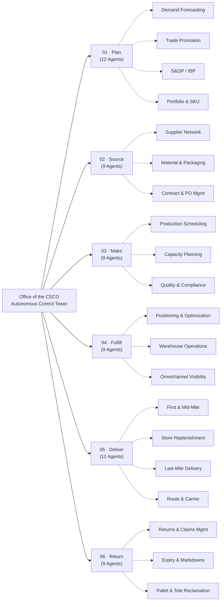

# Gemini Enterprise — Supply Chain & Demand (Office of the CSCO) Agentic Transformation

> **Built by Zuhaib Parvez & Suman Banerjee**  
> **6 ASCM SCOR Pillars · 20 Sub-Pillars · 60 Supply Chain Personas · 60 High-ROI AI Agents · 180 Collaborating A2A Sub-Agents · 245 Demo Data Tables**

[](https://www.ascm.org/)
[](https://cloud.google.com/vertex-ai)
[](https://cloud.google.com/gemini)
[](agents/)
[](agents/)

---

## 🌟 Executive Overview & Interactive Web Portals

This repository delivers an end-to-end, enterprise-grade AI transformation platform for the **Office of the Chief Supply Chain Officer (CSCO)**. Built upon the **ASCM SCOR Digital Standard (SCOR DS v14.0)** and Google's Agent Development Kit (ADK), it provides **60 purpose-built autonomous agents** operating across **6 core supply chain pillars** and **20 specialized sub-pillars**.

Every single agent is backed by grounded BigQuery demo data, deterministic mathematical solvers (OR-Tools MILP, TimesFM, Spanner Graph, Google Maps), and native **A2UI Interactive Cockpits** rendering directly inside Gemini Enterprise.

### Interactive Experiences & Documentation Directory

| Portal / View | File Path | Description |
| :--- | :--- | :--- |
| **1. Main Executive Portal** | [`index.html`](index.html) (`docs/index.html`) | Full-screen 60fps CSCO command center, 6 SCOR Pillar breakdown, 60 Persona hubs, 60 Agent studios with 3D CAD models, and 4 End-to-End Value Chains. |
| **2. Periodic Table of Supply Chain AI** | [`periodic_table.html`](periodic_table.html) | Interactive Periodic Table organizing all **60 AI Agent Elements** paired with **60 Supply Chain Personas**. Click any element to inspect its ROI, systems, and solver stack. |
| **3. Neural Mind Map & Click-Path** | [`mind_map.html`](mind_map.html) | Interactive 6-step click-path flowchart and full-screen synaptic graph showing how CSCO intent flows into pillars, personas, and cooperating agents. |
| **4. Agent Testing & Video Playbook** | [`agent_testing_and_video_playbook.html`](agent_testing_and_video_playbook.html) | Complete interactive testing manual with video demonstrations, verified test prompts, and copy-ready evaluation scripts. |
| **5. Written Testing Playbook** | [`AGENT_TESTING_AND_VIDEO_PLAYBOOK.md`](AGENT_TESTING_AND_VIDEO_PLAYBOOK.md) | Exhaustive Markdown testing manual detailing input prompts, expected reasoning paths, and ERP writeback payloads. |
| **6. Machine-Readable Catalog** | [`data/supply_chain_catalog.json`](data/supply_chain_catalog.json) | The single source of truth: 60 agents, 6 pillars, 20 subpillars, 60 personas, and 245 demo data tables. |

---

## 🏛️ The 6 ASCM SCOR Pillars & 60 AI Agents



### Complete 60-Agent Master Inventory

| # | Agent Name & Architecture | Pillar | Sub-Pillar | Target Persona | Primary Outcome / ROI |
| :---: | :--- | :---: | :--- | :--- | :--- |
| **01** | [`Demand Sensing Agent`](agents/demand_sensing_agent/README.md) | `01 · Plan` | `Demand Forecasting` | Demand Planner / Forecaster | `-20%–35% Short-Term WAPE` |
| **02** | [`Forecast Reconciliation`](agents/cpfr_sync_agent/README.md) | `01 · Plan` | `Demand Forecasting` | Commercial Planning Lead | `-40%–55% CPFR Variance` |
| **03** | [`NPI Demand Profiler`](agents/npi_demand_profiler/README.md) | `01 · Plan` | `Demand Forecasting` | Brand & Innovation Manager | `-30% Launch Forecast Error` |
| **04** | [`Promo ROI Simulator`](agents/promo_lift_simulator/README.md) | `01 · Plan` | `Trade Promotion` | Trade Marketing Manager | `+15%–25% Promo Net ROI` |
| **05** | [`JBP Negotiation Agent`](agents/field_beat_distributor_sync_agent/README.md) | `01 · Plan` | `Trade Promotion` | Key Account Manager (KAM) | `+2–4 pts JBP Margin` |
| **06** | [`Deduction Audit Agent`](agents/trade_scheme_claims_reconciler/README.md) | `01 · Plan` | `Trade Promotion` | Revenue / Trade Finance Lead | `Recovers 1.5%–3% Trade Spend` |
| **07** | [`Consensus & Gap Agent`](agents/sop_scenario_weaver/README.md) | `01 · Plan` | `S&OP / IBP` | S&OP / Supply Planning Dir. | `+1.5–3 pts EBITDA Protection` |
| **08** | [`Digital War-Room Agent`](agents/disruption_war_room_orchestrator/README.md) | `01 · Plan` | `S&OP / IBP` | Supply Chain VP / COO | `Protects 97%+ Strategic OTIF` |
| **09** | [`Executive Copilot`](agents/csco_control_tower_copilot/README.md) | `01 · Plan` | `S&OP / IBP` | IBP Lead / Chief Planning Off. | `-85% Executive Latency` |
| **10** | [`SKU Pruning Agent`](agents/working_capital_cash_bridge/README.md) | `01 · Plan` | `Portfolio & SKU` | Category Manager | `Frees 12%–20% Tail Capital` |
| **11** | [`PIPO Run-Out Agent`](agents/eco_cutover_orchestrator/README.md) | `01 · Plan` | `Portfolio & SKU` | Lifecycle / Materials Mgr | `-60%–80% Obsolescence Scrap` |
| **12** | [`Cost-to-Serve Diagnostic`](agents/network_twin_architect/README.md) | `01 · Plan` | `Portfolio & SKU` | Commercial Finance Director | `-6%–11% Network Cost-to-Serve` |
| **13** | [`Disruption Sensing Agent`](agents/tier_n_risk_sentinel/README.md) | `01 · Plan` | `Supplier Network` | Procurement Dir. / Risk Mgr | `-55% Disruption Downtime` |
| **14** | [`Onboarding & Qual. Agent`](agents/supplier_quality_sentinel/README.md) | `01 · Plan` | `Supplier Network` | Procurement Operations Lead | `-80% Onboarding Cycle Time` |
| **15** | [`ESG & Scope 3 Auditor`](agents/carbon_scope3_ledger/README.md) | `01 · Plan` | `Supplier Network` | Chief Sustainability Officer | `100% Audit-Ready Scope 3` |
| **16** | [`Commodity Index Advisor`](agents/commodity_index_advisor/README.md) | `01 · Plan` | `Material & Packaging` | Category Sourcing Mgr (Direct) | `-4%–8% Direct Material Spend` |
| **17** | [`Dynamic Should-Cost Agent`](agents/rfq_should_cost_agent/README.md) | `01 · Plan` | `Material & Packaging` | Strategic Sourcing Lead | `5%–10% RFP Spend Savings` |
| **18** | [`Sustainable Packaging Agent`](agents/sustainable_packaging_agent/README.md) | `01 · Plan` | `Material & Packaging` | Packaging R&D Engineer | `-15%–25% EPR & Spec Cost` |
| **19** | [`Contract Leakage Agent`](agents/tariff_esg_agent/README.md) | `01 · Plan` | `Contract & PO Mgmt` | Commercial Sourcing / Legal | `Recovers 2%–4% Addressable Spend` |
| **20** | [`PO Expediting Agent`](agents/master_data_leadtime_steward/README.md) | `01 · Plan` | `Contract & PO Mgmt` | Buyer / Procurement Coord. | `-35%–50% Expedite Freight` |
| **21** | [`Three-Way Match Dispute`](agents/three_way_match_dispute/README.md) | `01 · Plan` | `Contract & PO Mgmt` | Accounts Payable Lead | `-80% Invoice Exception Cost` |
| **22** | [`Changeover Optimizer`](agents/finite_production_scheduler/README.md) | `01 · Plan` | `Production Scheduling` | Master Production Scheduler | `+4–7 pts Line OEE Lift` |
| **23** | [`Disruption Re-sequencer`](agents/line_schedule_optimizer/README.md) | `01 · Plan` | `Production Scheduling` | Shop Floor / Shift Lead | `-40% Disruption Output Loss` |
| **24** | [`Labor & Line Balancing`](agents/labor_line_balancing_agent/README.md) | `01 · Plan` | `Production Scheduling` | Plant Operations Manager | `+8%–12% Direct Labor Output` |
| **25** | [`Bottleneck Diagnostic`](agents/predictive_oee_sentinel/README.md) | `01 · Plan` | `Capacity Planning` | Supply Chain Ops Director | `-30%–45% Unplanned Stops` |
| **26** | [`Co-Packer Allocation`](agents/copacker_allocation_agent/README.md) | `01 · Plan` | `Capacity Planning` | External Sourcing / CMO Lead | `-8%–14% External Tolling Cost` |
| **27** | [`CapEx Simulator`](agents/capex_simulator_agent/README.md) | `01 · Plan` | `Capacity Planning` | VP Manufacturing Engineering | `Avoids 15%–25% Idle CapEx` |
| **28** | [`Visual Defect Triager`](agents/inline_yield_guardian/README.md) | `01 · Plan` | `Quality & Compliance` | QA Manager / Line Inspector | `-35%–50% Quality Scrap` |
| **29** | [`Batch Record Auditor`](agents/batch_record_auditor/README.md) | `01 · Plan` | `Quality & Compliance` | Regulatory Compliance Lead | `-70% Batch Release Lead Time` |
| **30** | [`RCA & CAPA Copilot`](agents/scrap_defect_root_cause_agent/README.md) | `01 · Plan` | `Quality & Compliance` | Continuous Improvement Lead | `-40%–55% Repeat Quality Loss` |
| **31** | [`Return Fraud Sentinel`](agents/reverse_rma_optimizer/README.md) | `01 · Plan` | `Returns & Claims Mgmt` | Reverse Logistics / Fraud Lead | `-25%–40% Return Fraud Loss` |
| **32** | [`Keep-It & Routing Advisor`](agents/keep_it_routing_advisor/README.md) | `01 · Plan` | `Returns & Claims Mgmt` | Customer Experience (CX) Lead | `+15%–22% Net Return Margin` |
| **33** | [`OS&D Freight Claims`](agents/osd_freight_claims_agent/README.md) | `01 · Plan` | `Returns & Claims Mgmt` | Claims Specialist / Controller | `2x Faster OS&D Cash Recovery` |
| **34** | [`Dynamic Markdown Agent`](agents/dynamic_markdown_agent/README.md) | `01 · Plan` | `Expiry & Markdowns` | Merchandising / Store Ops Mgr | `-22%–35% Expiry Shrink` |
| **35** | [`Short-Dated Redistributor`](agents/short_dated_redistributor/README.md) | `01 · Plan` | `Expiry & Markdowns` | Inventory Disposition Lead | `Diverts 30%–45% At-Risk Lots` |
| **36** | [`Food Waste & ESG Copilot`](agents/food_waste_esg_copilot/README.md) | `01 · Plan` | `Expiry & Markdowns` | Chief Sustainability Officer | `-75% ESG Reporting Cost` |
| **37** | [`RTI Balance Reconciler`](agents/rti_balance_reconciler/README.md) | `01 · Plan` | `Pallet & Tote Reclamation` | Asset Recovery / RTI Manager | `-25%–35% RTI Replacement Cost` |
| **38** | [`Milk-Run Consolidation`](agents/intermodal_rail_linehaul_agent/README.md) | `01 · Plan` | `Pallet & Tote Reclamation` | Reverse Transport Planner | `-20%–30% Reverse Haul Cost` |
| **39** | [`Sanitation & Health Agent`](agents/sanitation_health_agent/README.md) | `01 · Plan` | `Pallet & Tote Reclamation` | Packaging QA / Food Safety | `Zero Sanitation Recall Breaches` |
| **40** | [`Safety Stock Agent`](agents/meio_safety_stock_agent/README.md) | `04 · Fulfill` | `Positioning & Optimization` | Inventory Optimization Lead | `-12%–22% Safety Stock Capital` |
| **41** | [`SLOB Disposition Agent`](agents/slob_disposition_agent/README.md) | `04 · Fulfill` | `Positioning & Optimization` | Inventory Controller / Buyer | `+25%–40% Aged Stock Recovery` |
| **42** | [`Inter-Facility Rebalancer`](agents/crossdock_transfer_orchestrator/README.md) | `04 · Fulfill` | `Positioning & Optimization` | Replenishment Planner | `-35%–50% Lost-Sale Stockouts` |
| **43** | [`Dynamic Slotting Agent`](agents/warehouse_slotting_agent/README.md) | `04 · Fulfill` | `Warehouse Operations` | DC Operations Mgr / IE Lead | `-15%–28% Picker Travel Time` |
| **44** | [`Dock-to-Stock Agent`](agents/dock_to_stock_agent/README.md) | `04 · Fulfill` | `Warehouse Operations` | Inbound Receiving Supervisor | `-75% Dock-to-Stock Latency` |
| **45** | [`Wave Fulfillment Copilot`](agents/wave_fulfillment_copilot/README.md) | `04 · Fulfill` | `Warehouse Operations` | DC Shift Floor Lead | `-30% DC Rush Overtime` |
| **46** | [`Phantom Inventory Sensor`](agents/planogram_merchandising_vision_auditor/README.md) | `04 · Fulfill` | `Omnichannel Visibility` | Store Operations / Omni Lead | `+2.5%–4% On-Shelf Sales Lift` |
| **47** | [`SFS / BOPIS Sourcing`](agents/atp_order_promising_agent/README.md) | `04 · Fulfill` | `Omnichannel Visibility` | Omnichannel Fulfillment Dir. | `-15%–25% Parcel & Split Cost` |
| **48** | [`Returns Triage Agent`](agents/returns_triage_agent/README.md) | `04 · Fulfill` | `Omnichannel Visibility` | Reverse Logistics Lead | `+18%–30% Full-Price Recovery` |
| **49** | [`Load Consolidation`](agents/load_consolidation_agent/README.md) | `05 · Deliver` | `First & Mid-Mile` | Transport Planner / Inbound Mgr | `+12%–18% Cube · -10% Trucks` |
| **50** | [`Yard Disruption Agent`](agents/yard_dock_sequencer/README.md) | `05 · Deliver` | `First & Mid-Mile` | Yard Master / Plant Logistics | `-60%–75% Yard Demurrage` |
| **51** | [`Cold-Chain Auditor`](agents/cold_chain_auditor/README.md) | `05 · Deliver` | `First & Mid-Mile` | Cold Chain QA / Logistics Dir. | `-50%–70% Cold-Chain Claims` |
| **52** | [`Aisle-Aligned Pallet`](agents/aisle_aligned_pallet_agent/README.md) | `05 · Deliver` | `Store Replenishment` | Outbound Lead / Industrial Eng. | `-20%–35% Store Unload Labor` |
| **53** | [`Store Capacity Agent`](agents/store_capacity_agent/README.md) | `05 · Deliver` | `Store Replenishment` | Store Replenishment Lead | `-25% Backroom Congestion` |
| **54** | [`Curfew Orchestrator`](agents/port_drayage_orchestrator/README.md) | `05 · Deliver` | `Store Replenishment` | Retail Logistics Dispatcher | `-80% Curfew & Slot Penalties` |
| **55** | [`Geocoding Intelligence`](agents/geocoding_intelligence_agent/README.md) | `05 · Deliver` | `Last-Mile Delivery` | Last-Mile Operations Lead | `-30%–45% Failed Deliveries` |
| **56** | [`Courier Allocation`](agents/multimodal_mode_shift_agent/README.md) | `05 · Deliver` | `Last-Mile Delivery` | E-Commerce Logistics Dir. | `-8%–14% Parcel & Courier Spend` |
| **57** | [`Delivery Exception Copilot`](agents/otif_penalty_shield/README.md) | `05 · Deliver` | `Last-Mile Delivery` | Customer Support Ops Lead | `-50%–65% WISMO & Chargebacks` |
| **58** | [`Dynamic Rerouter`](agents/fleetflow_dispatch/README.md) | `05 · Deliver` | `Route & Carrier` | Fleet Dispatcher / Central Ops | `-6%–11% Fleet Miles & Fuel` |
| **59** | [`Routing Guide Compliance`](agents/freight_control_tower/README.md) | `05 · Deliver` | `Route & Carrier` | Transport Procurement Lead | `-15%–22% Spot Freight Spend` |
| **60** | [`Freight Bill Audit Agent`](agents/freight_bill_audit_agent/README.md) | `05 · Deliver` | `Route & Carrier` | Freight Controller / Claims | `Recovers 3%–7% Freight Spend` |

---

## 🚀 Quick-Start Guide

### 1. Launch the Local Web Portal
You can run the full interactive executive portal locally with Python's built-in HTTP server:

```bash
# Clone the repository
git clone https://github.com/zuhaibp656/Supply-Chain-Agentic-Transformation.git
cd Supply_chain_Agentic_Transformation

# Start local web server
python3 -m http.server 8000

# Open in browser:
# - Executive Portal:    http://localhost:8000/index.html
# - Periodic Table:      http://localhost:8000/periodic_table.html
# - Neural Mind Map:     http://localhost:8000/mind_map.html
# - Testing Playbook:    http://localhost:8000/agent_testing_and_video_playbook.html
```

---

### 2. Deploy Agents to Google Cloud Vertex AI & Gemini Enterprise

All agents are built with **Google Agent Development Kit (ADK)** and can be deployed directly to Vertex AI Reasoning Engine and registered in Gemini Enterprise with one command.

#### Prerequisites:
- Google Cloud Project with Vertex AI and BigQuery APIs enabled.
- Authenticated with `gcloud auth application-default login`.

#### Single Agent Deployment:
To deploy any single agent (e.g. `demand_sensing_agent` or `load_consolidation_agent`):
```bash
python3 scripts/deploy_to_gemini_enterprise.py --agent demand_sensing_agent
```

#### Curated 25 Showcase Deployment:
Deploys the 25 flagship showcase agents covering all 6 Pillars and all 20 Sub-Pillars in-place:
```bash
python3 scripts/deploy_to_gemini_enterprise.py --curated-showcase
```

#### Full Portfolio Deployment (All 60 Agents):
```bash
python3 scripts/deploy_to_gemini_enterprise.py --all-60
```

---

## 💾 Connected Demo Data Lake

The platform includes **245 realistic enterprise fixture tables** located locally under each agent's `fixtures/tables/*.json` and synchronized in Google BigQuery under `zuhaibp-ai:supply_chain_twin`.

### Key Connected Systems:
- **ERP**: SAP S/4HANA (MM, PP, QM, SD, PM, FI, aATP), Kinaxis RapidResponse, Blue Yonder, Oracle SCM.
- **WMS & TMS**: Manhattan Active WMS, Blue Yonder TMS, Dematic AS/RS WCS, Samsara ELD.
- **External Feeds**: Google WeatherNext 3, Google Maps Routes Preferred API, Spire Global Maritime AIS, Railinc EDI, D&B Supplier Risk.
- **Mathematical Solvers**: Google OR-Tools CP-SAT & MILP, Vertex AI TimesFM, BigQuery ML, Cloud Spanner Graph.

---

## 🛡️ Enterprise Governance & Standards Compliance

- **ASCM SCOR Digital Standard (SCOR DS v14.0)**: Strict adherence to industry-standard supply chain processes (Plan, Source, Make, Fulfill, Deliver, Return).
- **A2UI Protocol (v0.9)**: Visual surface separation rendering charts and interactive HTML in side-panel canvases while keeping text, tables, and write-back receipts outside in standard markdown.
- **Zero Hallucination Guardrails**: Deterministic pre-tool validation hooks checking SLA constraints, business rules, and non-empty `idempotency_key` values before ERP execution.
- **Data Privacy & VPC Sovereignty**: Zero third-party telemetry; enterprise data remains isolated within your Google Cloud project boundary.

---

## 👥 Authors & Leadership
- **Zuhaib Parvez** — Google Cloud AI & Advanced Agentic Architect
- **Suman Banerjee** — Supply Chain Strategy & Transformation Leader
