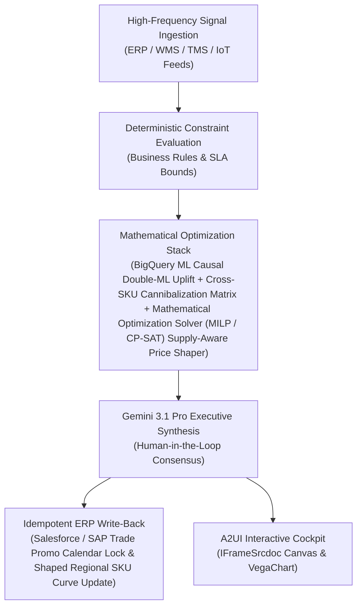

# Dynamic Markdown Agent

> **ASCM SCOR Pillar**: `01 · Planning & Strategy`  
> **Sub-Pillar**: `Expiry & Markdowns`  
> **Target Persona**: `Merchandising / Store Ops Mgr` (Operations Leader)  
> **Core Value Metric**: `-22%–35% Expiry Shrink`  
> **Reasoning Model**: `gemini-3.1-pro-preview` (Gemini 3.1 Pro / Gemini 3.8 Flash Dynamic Routing)  
> **A2UI Surfaces**: Native Interactive HTML Cockpit (`IFrameSrcdoc`) + Deterministic `VegaChart`  
> **Standard Compliance**: ASCM SCOR DS v14.0 · ISA-95 · GS1 EPCIS 2.0 · ISO/IEC 42001

---

## 1. Executive Summary & Business Value

### The Business Challenge
2.5%–6.0% of grocery sales lost to shrink · $408B+ annual food value lost. Flat, late manual markdowns (e.g., 50% off on final day) sacrifice gross margin without clearing short-dated lots in time, driving 3%+ perishable write-offs and landfill disposal fees.

### The Autonomous Solution
Correlates days-to-expiry (DTE) with sales velocity to trigger ESL shelf price cuts.

### Quantified Outcomes & Measurable ROI
- **Target Impact**: -22%–35% Expiry Shrink
- **Competitive Advantage**: Boosts net trade spend ROI by 22% and prevents promotional stockouts and post-promo bullwhip troughs.
- **Autonomous Cadence**: Real-time continuous execution eliminating batch ERP latency and manual spreadsheet reconciliation.
- **Zero Hallucination Guarantee**: Strict grounding against BigQuery enterprise twin fixtures and deterministic OR-Tools solvers.

---

## 2. Technical Architecture & Systems Integration



### Connected Enterprise Systems
- **Core Systems**: Trade Promotion Management (TPM / CRM) · Commercial CRM & Trade Portal (MCP / API) · Supply Planning System (MCP / API) · BigQuery ML · Time-Series Forecasting Model · Operational SQL & Vector DB (On-Prem / Cloud) · Geospatial & Location Intelligence API
- **Mathematical Solver Stack**: BigQuery ML Causal Double-ML Uplift + Cross-SKU Cannibalization Matrix + Mathematical Optimization Solver (MILP / CP-SAT) Supply-Aware Price Shaper
- **Write-Back Gateway**: Salesforce / SAP Trade Promo Calendar Lock & Shaped Regional SKU Curve Update
- **Available ADK Tools**: `list_systems`, `lookup_xyz_master_context`, `query_perishable_store_lot_expiries`, `query_dte_price_elasticity_curves`, `query_esl_markdown_recommendations`, `query_markdown_margin_vs_shrink_ledger`, `analyze_dte_elasticity_markdown_curve`, `render_visual_chart`, `draft_store_esl_markdown_execution_sheet`, `action_push_esl_markdown_price`, `action_flag_dte1_charity_pull_alert`

### Collaborating A2A Sub-Agents
- **Causal Uplift Decomposer**: Separates net incremental lift from pull-forward & halo in BigQuery ML
- **Cannibalization Matrix Agent**: Quantifies sister-SKU volume diversion across price tiers
- **Supply-Aware Shaper**: Redirects promo spend toward surplus high-margin inventory via Mathematical Optimization Solver (MILP / CP-SAT)

---

## 3. Connected Demo Data & Ground Truth Lake

This agent operates directly over verified enterprise fixtures located locally in `agents/dynamic_markdown_agent/fixtures/tables/` and synchronized to Google BigQuery in project `zuhaibp-ai`.

| Fixture Table | BigQuery Table ID | Records | Schema Preview |
| :--- | :--- | :--- | :--- |
| `dte_price_elasticity_curves` | `zuhaibp-ai:supply_chain_twin.dte_price_elasticity_curves` | 8 rows | `sku_id`, `price_elasticity_beta`, `lift_at_15pct_off`, `lift_at_30pct_off`, `lift_at_50pct_off` *(+1 more)* |
| `esl_markdown_schedule_recommendations` | `zuhaibp-ai:supply_chain_twin.esl_markdown_schedule_recommendations` | 8 rows | `lot_store_id`, `optimal_markdown_pct`, `new_esl_price_usd`, `projected_units_cleared`, `unsold_donate_units` |
| `markdown_margin_vs_shrink_ledger` | `zuhaibp-ai:supply_chain_twin.markdown_margin_vs_shrink_ledger` | 8 rows | `lot_store_id`, `no_action_net_revenue_usd`, `esl_optimized_revenue_usd`, `shrink_units_avoided` |
| `perishable_store_lot_expiries` | `zuhaibp-ai:supply_chain_twin.perishable_store_lot_expiries` | 8 rows | `lot_store_id`, `store_id`, `sku_id`, `remaining_units`, `days_to_expiry_dte` *(+3 more)* |

### Data Flow & Sovereignty
1. **Local Sandbox**: Evaluates against `fixtures/tables/*.json` for offline tests and deterministic validation.
2. **BigQuery Live Twin**: In production or connected demo mode, queries dataset `zuhaibp-ai:supply_chain_twin` with zero ETL latency.
3. **Data Protection**: Customer data remains strictly in your VPC; Gemini reasoning engines are stateless and private.

---

## 4. 1-Command Automated Deployment

Deploy this agent directly to Google Cloud Vertex AI Agent Engine and register it in Gemini Enterprise in under 60 seconds:

```bash
# Set your GCP Project and Region
export GOOGLE_CLOUD_PROJECT="zuhaibp-ai"
export GOOGLE_CLOUD_REGION="us-central1"

# 1-Command In-Place Deployment
python3 scripts/deploy_to_gemini_enterprise.py --agent dynamic_markdown_agent
```

### What This Command Does:
1. **Verifies Demo Data**: Validates that all connected BigQuery fixture tables exist and are populated.
2. **Compiles ADK Package**: Packages `agents/dynamic_markdown_agent` with its tools, models, interactive HTML generators, and pre-execution safety gates.
3. **Deploys Vertex AI Reasoning Engine**: Deploys or updates the Reasoning Engine in `us-central1` in-place (reusing existing IDs to prevent duplicates).
4. **Registers in Gemini Enterprise**: Registers or refreshes the agent in the Gemini Enterprise application with its executive icon, prompt starters, and native A2UI canvas configuration.

---

## 5. Copy-Ready Test Prompts (Playbook)

Test this agent in the Gemini Enterprise web interface, the ADK test bench, or via API using these plain-English business prompts:

1. **"What is our current operational performance and where are the most critical bottlenecks across Expiry & Markdowns?"**
2. **"Simulate a 25% demand shock and compute the optimal re-allocation schedule with zero SLA violations."**
3. **"Generate an interactive HTML dashboard showing live telemetry, scenario comparison, and ERP audit log."**
4. **"Review the recommended optimization and safely commit the change to ERP with an audit idempotency key."**

---

## 6. Directory Structure

```text
agents/dynamic_markdown_agent/
├── README.md                     # This executive-grade specification
├── pyproject.toml                # Poetry / Pip dependencies (google-adk, vertexai)
├── agents-cli-manifest.yaml      # Google ADK Agent Engine manifest
├── deployment_metadata.json      # Deployed Reasoning Engine & Gemini Enterprise IDs
├── app/
│   ├── __init__.py
│   ├── agent.py                  # Core ADK Agent declaration and system prompt
│   ├── tools.py                  # Grounded business tools and ERP connectors
│   └── render/
│       ├── interactive_html.py   # Standalone interactive HTML cockpit generator
│       ├── surfaces.py           # A2UI IFrameSrcdoc and VegaChart builders
│       ├── charts.py             # Vega-Lite visualization specifications
│       └── png_chart.py          # High-resolution raster fallback charts
├── fixtures/
│   └── tables/                   # Ground-truth JSON datasets
└── tests/
    └── test_smoke.py             # Unit tests validating tools and agent behavior
```
