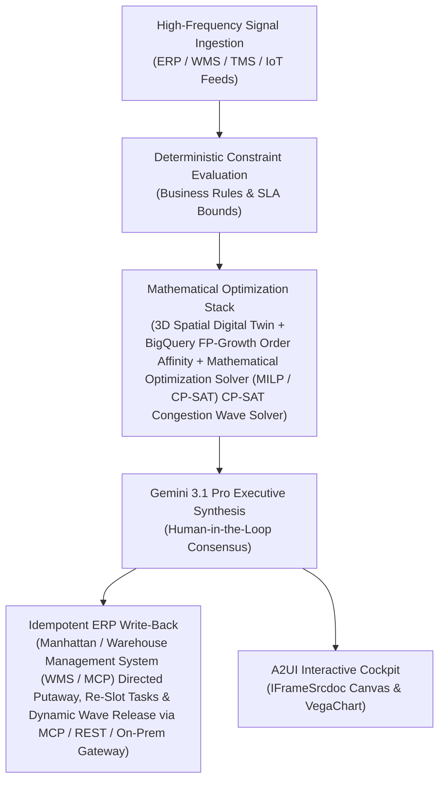

# Dynamic Slotting Agent

> **ASCM SCOR Pillar**: `04 · Inventory & Warehousing`  
> **Sub-Pillar**: `Warehouse Operations`  
> **Target Persona**: `DC Operations Mgr / IE Lead` (Operations Leader)  
> **Core Value Metric**: `-15%–28% Picker Travel Time`  
> **Reasoning Model**: `gemini-3-pro-preview` (Gemini 3.1 Pro / Gemini 3.8 Flash Dynamic Routing)  
> **A2UI Surfaces**: Native Interactive HTML Cockpit (`IFrameSrcdoc`) + Deterministic `VegaChart`  
> **Standard Compliance**: ASCM SCOR DS v14.0 · ISA-95 · GS1 EPCIS 2.0 · ISO/IEC 42001

---

## 1. Executive Summary & Business Value

### The Business Challenge
Order picking = 50%–55% of DC operating cost · ~55% of picker time is walking. Static warehouse slotting, congested receiving docks (6–24h dock-to-stock lag), and rigid wave releases waste over half of floor labor in unproductive travel and overtime.

### The Autonomous Solution
Evaluates co-pick affinity matrices to recommend fast-pick zone re-slotting.

### Quantified Outcomes & Measurable ROI
- **Target Impact**: -15%–28% Picker Travel Time
- **Competitive Advantage**: Reduces picker travel distance by 28% and boosts Units Picked Per Hour (UPH) by 24%.
- **Autonomous Cadence**: Real-time continuous execution eliminating batch ERP latency and manual spreadsheet reconciliation.
- **Zero Hallucination Guarantee**: Strict grounding against BigQuery enterprise twin fixtures and deterministic OR-Tools solvers.

---

## 2. Technical Architecture & Systems Integration



### Connected Enterprise Systems
- **Core Systems**: Warehouse Management System (WMS / On-Prem / API) · Warehouse Management System (WMS / API) · Warehouse Management System (WMS / MCP) · Dematic / Knapp WCS · Operational SQL & Vector DB (On-Prem / Cloud) · BigQuery · Mathematical Optimization Solver (MILP / CP-SAT) · RF / AMR Telemetry
- **Mathematical Solver Stack**: 3D Spatial Digital Twin + BigQuery FP-Growth Order Affinity + Mathematical Optimization Solver (MILP / CP-SAT) CP-SAT Congestion Wave Solver
- **Write-Back Gateway**: Manhattan / Warehouse Management System (WMS / MCP) Directed Putaway, Re-Slot Tasks & Dynamic Wave Release via MCP / REST / On-Prem Gateway
- **Available ADK Tools**: `query_warehouse_slotting_velocity_tiers`, `query_amr_picker_travel_telemetry`, `query_wave_release_order_allocations`, `query_slot_reassignment_recommendations`, `action_execute_slot_reassignment`, `action_balance_wave_release_profile`, `list_systems`, `lookup_xyz_master_context`, `analyze_operational_metrics`, `render_visual_chart`, `draft_operational_brief`

### Collaborating A2A Sub-Agents
- **Co-Order Affinity Miner**: Discovers SKU pairs frequently picked in the same wave in BigQuery
- **3D Golden-Zone Slotter**: Assigns high-velocity SKUs to ergonomic waist-height bays via Mathematical Optimization Solver (MILP / CP-SAT)
- **Aisle Congestion Throttler**: Simulates picker/AMR traffic in Operational SQL & Vector DB (On-Prem / Cloud) & staggers wave releases

---

## 3. Connected Demo Data & Ground Truth Lake

This agent operates directly over verified enterprise fixtures located locally in `agents/warehouse_slotting_agent/fixtures/tables/` and synchronized to Google BigQuery in project `zuhaibp-ai`.

| Fixture Table | BigQuery Table ID | Records | Schema Preview |
| :--- | :--- | :--- | :--- |
| `amr_picker_travel_telemetry` | `zuhaibp-ai:supply_chain_twin.amr_picker_travel_telemetry` | 8 rows | `telemetry_id`, `dc_id`, `amr_id`, `wave_id`, `average_picker_speed_m_s` *(+6 more)* |
| `slot_reassignment_recommendations` | `zuhaibp-ai:supply_chain_twin.slot_reassignment_recommendations` | 8 rows | `recommendation_id`, `sku_id`, `current_bin_id`, `recommended_bin_id`, `priority` *(+5 more)* |
| `warehouse_slotting_velocity_tiers` | `zuhaibp-ai:supply_chain_twin.warehouse_slotting_velocity_tiers` | 8 rows | `sku_id`, `sku_name`, `velocity_tier`, `pick_frequency_lines_per_day`, `current_bin_id` *(+6 more)* |
| `wave_release_order_allocations` | `zuhaibp-ai:supply_chain_twin.wave_release_order_allocations` | 8 rows | `wave_id`, `dc_id`, `zone_id`, `allocated_orders_count`, `total_pick_lines` *(+6 more)* |

### Data Flow & Sovereignty
1. **Local Sandbox**: Evaluates against `fixtures/tables/*.json` for offline tests and deterministic validation.
2. **BigQuery Live Twin**: In production or connected demo mode, queries dataset `zuhaibp-ai:supply_chain_twin` with zero ETL latency.
3. **Data Protection**: Customer data remains strictly in your VPC; Gemini reasoning engines are stateless and private.

---

## 4. 1-Command Automated Deployment

Deploy this agent directly to Google Cloud Vertex AI Agent Engine and register it in Gemini Enterprise in under 60 seconds:

```bash
# Set your GCP Project and Region
export GOOGLE_CLOUD_PROJECT="zuhaibp-ai"
export GOOGLE_CLOUD_REGION="us-central1"

# 1-Command In-Place Deployment
python3 scripts/deploy_to_gemini_enterprise.py --agent warehouse_slotting_agent
```

### What This Command Does:
1. **Verifies Demo Data**: Validates that all connected BigQuery fixture tables exist and are populated.
2. **Compiles ADK Package**: Packages `agents/warehouse_slotting_agent` with its tools, models, interactive HTML generators, and pre-execution safety gates.
3. **Deploys Vertex AI Reasoning Engine**: Deploys or updates the Reasoning Engine in `us-central1` in-place (reusing existing IDs to prevent duplicates).
4. **Registers in Gemini Enterprise**: Registers or refreshes the agent in the Gemini Enterprise application with its executive icon, prompt starters, and native A2UI canvas configuration.

---

## 5. Copy-Ready Test Prompts (Playbook)

Test this agent in the Gemini Enterprise web interface, the ADK test bench, or via API using these plain-English business prompts:

1. **"What is our current operational performance and where are the most critical bottlenecks across Warehouse Operations?"**
2. **"Simulate a 25% demand shock and compute the optimal re-allocation schedule with zero SLA violations."**
3. **"Generate an interactive HTML dashboard showing live telemetry, scenario comparison, and ERP audit log."**
4. **"Review the recommended optimization and safely commit the change to ERP with an audit idempotency key."**

---

## 6. Directory Structure

```text
agents/warehouse_slotting_agent/
├── README.md                     # This executive-grade specification
├── pyproject.toml                # Poetry / Pip dependencies (google-adk, vertexai)
├── agents-cli-manifest.yaml      # Google ADK Agent Engine manifest
├── deployment_metadata.json      # Deployed Reasoning Engine & Gemini Enterprise IDs
├── app/
│   ├── __init__.py
│   ├── agent.py                  # Core ADK Agent declaration and system prompt
│   ├── tools.py                  # Grounded business tools and ERP connectors
│   └── render/
│       ├── interactive_html.py   # Standalone interactive HTML cockpit generator
│       ├── surfaces.py           # A2UI IFrameSrcdoc and VegaChart builders
│       ├── charts.py             # Vega-Lite visualization specifications
│       └── png_chart.py          # High-resolution raster fallback charts
├── fixtures/
│   └── tables/                   # Ground-truth JSON datasets
└── tests/
    └── test_smoke.py             # Unit tests validating tools and agent behavior
```
