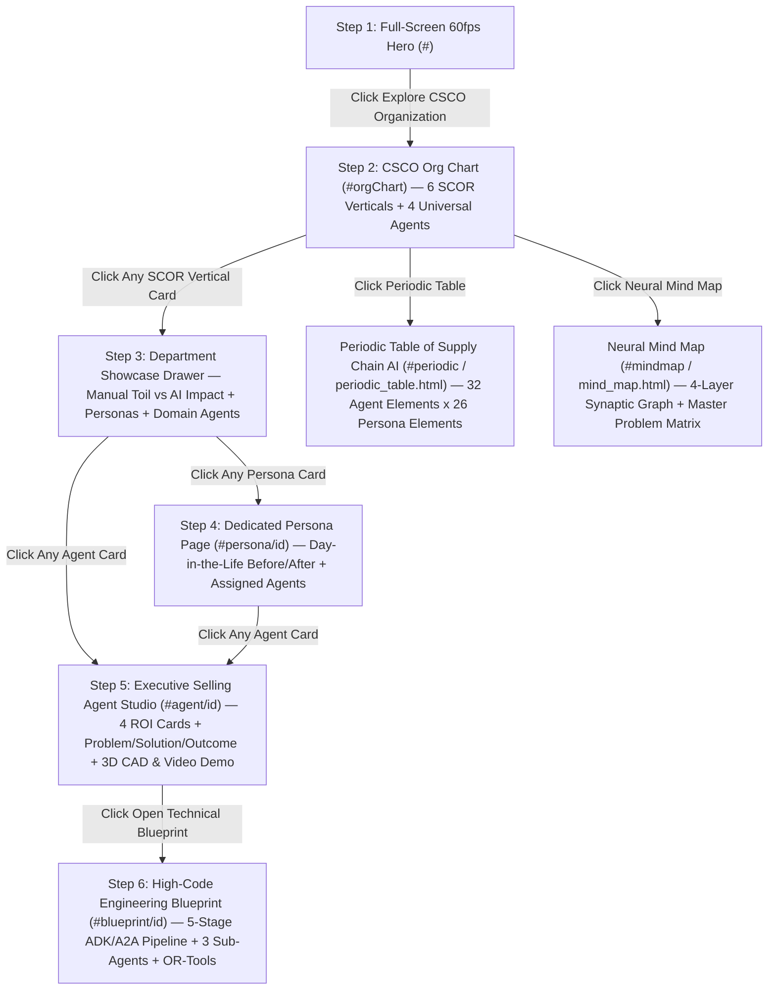

# Supply Chain & Demand Agentic AI — Neural Mind Map & Periodic Table Guide

> **Built by Zuhaib Parvez & Suman Banerjee** · *Office of the CSCO Agentic Transformation*

## 1. Portal Navigation Flowchart ("If You Click Here → What Opens Up")

## 2. Periodic Table of 32 Supply Chain AI Agents (Elements 01 – 32)

| Atomic # | Symbol | Short Name | Full Agent Name | SCOR Group | Primary KPI | Core Problem Solved |
| :--- | :--- | :--- | :--- | :--- | :--- | :--- |
| **#01** | **`Ct`** | TowerMind | TowerMind — Enterprise Control Tower & Conversational Copilot | `universal_csco` | **90s Cross-Silo Decisions** | Supply chain executives and planners wait days for analysts to pull data across disconnected ERP, WMS, TMS, ocean/air/rail portals, and procurement silos just to answer a single cross-functional question. |
| **#02** | **`Sw`** | StormShield | StormShield — WeatherNext 3 & Global Disruption War-Room Agent | `universal_csco` | **72-Hr Disruption Lead** | Severe weather, port strikes, airspace closures, and geopolitical shocks are managed in reactive war-rooms days after vessels queue and roads close—forcing expensive spot expedites and lost sales. |
| **#03** | **`Dc`** | DataCleanse | DataCleanse — Autonomous ERP Master Data, BOM & Lead-Time Steward | `universal_csco` | **99.8% Master Data Hygiene** | Even the best AI and mathematical solvers fail if ERP master data still lists a 14-day supplier or ocean transit time that actually takes 26 days, or wrong carton dimensions that break 3D aircraft ULD and truck loading. |
| **#04** | **`Mb`** | MarginBridge | MarginBridge — CSCO-to-CFO Working Capital & Cash-to-Cash Agent | `universal_csco` | **+$42M Free Cash Flow** | Supply chain teams optimize physical KPIs (fill rate, OEE, container/truck fill) in units while Finance optimizes P&L and cash flow in dollars—leading to disconnected inventory write-offs and margin erosion. |
| **#05** | **`Pc`** | PulseCast | PulseCast — Multi-Signal Demand Sensing Engine | `demand_sop` | **-6.4 pts WAPE** | Traditional ERP forecasting relies on historical ship-to orders distorted by stockouts and batch ordering—lagging real market consumption shifts by 2 to 4 weeks and inflating safety buffers. |
| **#06** | **`Sy`** | Synapse S&OP | Synapse — Autonomous S&OP Scenario Weaver | `demand_sop` | **21 Days → 45 Mins** | Sequential spreadsheet handoffs across Demand, Manufacturing, Procurement, Logistics, and Finance take 21 days—rendering monthly S&OP consensus plans obsolete before executives even sign off. |
| **#07** | **`Eq`** | ElasticityIQ | ElasticityIQ — Demand Shaping & Promo Simulator | `demand_sop` | **+22% Promo ROI** | Uncoordinated trade promotions spike demand on capacity-constrained SKUs while silently cannibalizing 30%+ of adjacent full-margin baseline items. |
| **#08** | **`Cs`** | ChannelSync | ChannelSync — Collaborative CPFR & POS Harmonizer | `demand_sop` | **+3.8 pts Retail OSA** | Planners spend hours downloading incompatible retailer portal spreadsheets while phantom store inventory hides on-shelf stockouts and bullwhip order swings. |
| **#09** | **`Sp`** | SourcePulse | SourcePulse — Parametric Should-Cost & Autonomous RFQ Agent | `sourcing_risk` | **-6.8% Direct Spend** | Category managers spend weeks normalizing messy supplier quote spreadsheets and negotiate without granular bottom-up commodity, manufacturing, and landed freight cost visibility. |
| **#10** | **`Nx`** | NexusShield | NexusShield — Multi-Tier Supply Network Sentinel | `sourcing_risk` | **+11 Days Warning** | 65% of supply chain disruptions originate in Tier-2 or Tier-3 sub-suppliers where legacy ERPs have zero visibility until Tier-1 misses factory delivery. |
| **#11** | **`Cg`** | ClauseGuard | ClauseGuard — Contract Intelligence & Trade Compliance Agent | `sourcing_risk` | **99.6% Compliance** | Earned volume rebates and commodity caps stay buried in PDF contracts, while manual HS tariff classification causes ocean/air customs holds and overpaid duties. |
| **#12** | **`Qs`** | QualiShield | QualiShield — Predictive Supplier Quality & NCR Resolver | `sourcing_risk` | **-64% Defect Escapes** | Out-of-spec supplier lots slip past manual PDF Certificate of Analysis (COA) checks and fixed sampling rules, causing costly factory line stops and rework. |
| **#13** | **`Cm`** | ChronosMake | ChronosMake — Finite Capacity Line & Changeover Optimizer | `manufacturing_prod` | **-32% Changeover · -25% Backorders** | Infinite-capacity ERP MRP schedules ignore sequence-dependent washdowns and tooling swaps—wasting 19% of line hours on avoidable changeovers and missing outbound vessel/rail/truck cutoffs. |
| **#14** | **`Sg`** | SpindleGuard | SpindleGuard — Predictive Asset OEE & MRO Spares Sentinel | `manufacturing_prod` | **+14.2 pts Plant OEE** | Unplanned machine breakdowns mid-batch halt factory lines for hours, scrap work-in-process, and force emergency air-freight of replacement spares. |
| **#15** | **`Yv`** | YieldVision | YieldVision — Inline Vision QA & Closed-Loop SPC Recipe Agent | `manufacturing_prod` | **-44% Plant Scrap** | End-of-line manual sampling discovers quality drift hours after thousands of defective units have already been produced, driving up scrap and quarantine holds. |
| **#16** | **`Ch`** | ChangeSync | ChangeSync — Engineering Change (ECO) & NPI Cutover Orchestrator | `manufacturing_prod` | **-58% Obsolete WIP** | Arbitrary Engineering Change Order (ECO) cutover dates strand millions of dollars of prior-revision components in warehouses, ocean containers, and open supplier POs. |
| **#17** | **`Ef`** | EchelonFlow | EchelonFlow — Multi-Echelon Inventory (MEIO) Optimizer | `inventory_warehouse` | **-18% Working Capital** | Single-echelon static ERP rules set safety buffers in isolation, trapping 24% excess working capital upstream while regional edge hubs still suffer stockouts. |
| **#18** | **`Sm`** | SlotMaster 3D | SlotMaster — 3D Warehouse Slotting & Wave Twin | `inventory_warehouse` | **-28% Picker Travel** | Static annual warehouse slotting forces pickers to walk miles for fast-moving or co-ordered SKUs, while uncoordinated wave releases gridlock narrow aisles. |
| **#19** | **`Pg`** | PromiseGuard | PromiseGuard — Dynamic Order Promising (ATP) Broker | `inventory_warehouse` | **-34% Split Shipments** | Rigid FIFO ERP order promising splits customer orders across 2 or 3 warehouses whenever a single line item is locally out of stock—destroying order margin. |
| **#20** | **`Yp`** | YardPulse | YardPulse — Autonomous Dock Door & Yard Sequencer | `inventory_warehouse` | **-41% Trailer Dwell** | Static whiteboard dock scheduling ignores live truck delays and interior staging congestion—causing gate bottlenecks, long yard hostler delays, and carrier detention bills. |
| **#21** | **`Xd`** | CrossDockFlow | CrossDockFlow — Port/Air/Rail-to-Warehouse Cross-Dock & Flow-Through Agent | `inventory_warehouse` | **-52% Cross-Dock Dwell** | Inbound ocean containers, air cargo pallets, and rail boxcars are blindly received into reserve warehouse racks and re-picked hours later—doubling warehouse labor and adding 24–48 hours of avoidable dwell. |
| **#22** | **`Cb`** | CubeMaster 3D | CubeMaster 3D — Isometric LIFO Bay & Load Consolidation Studio | `logistics_fleet` | **92% Cube · 100% LIFO** | Routes that fit by scalar weight/volume fail on the dock because Stop-1 cargo gets buried behind Stop-5 cargo or overloads highway drive-axle limits. |
| **#23** | **`Ff`** | FleetFlow Maps | FleetFlow — Google Maps Corridor Route & Fleet Dispatch Studio | `logistics_fleet` | **-19.4% Fleet Cost** | Manual postcode routing creates criss-crossing multi-truck spaghetti paths, poor vehicle-class sizing, and missed customer delivery time windows. |
| **#24** | **`Pw`** | PortWatch Sea | PortWatch — Global Ocean Vessel, Container Stowage & Port Drayage Orchestrator | `logistics_fleet` | **-67% Demurrage Fees** | Ocean containers sit at congested port terminals accruing $350+/day demurrage fees while regional DCs stock out waiting for slow inland transit. |
| **#25** | **`Af`** | AeroFreight Air | AeroFreight — Air Cargo Charter, Belly Allocation & 3D ULD Contour Optimizer | `logistics_fleet` | **-28% Air Freight Cost** | Emergency air shipments suffer 25%+ volumetric chargeable-weight waste inside contoured aircraft ULDs and miss tight hub connections due to blind forwarder milestone lag. |
| **#26** | **`Ir`** | IntermodalSync | IntermodalSync — Factory-to-DC Intermodal Rail, Barge & Linehaul Orchestrator | `logistics_fleet` | **-34% Linehaul Cost** | Long-haul freight defaults to expensive over-the-road diesel trucks because planners distrust rail ramp dwell variability and struggle to coordinate origin/destination drayage chassis. |
| **#27** | **`Ms`** | ModalShift | ModalShift — Factory→Ship→Air→Rail→Truck Dynamic Mode-Switch Broker | `logistics_fleet` | **-24% Total Transit Cost** | Static ERP routing guides lock entire purchase orders onto a single transport mode—either shipping everything by slow ocean (causing stockouts) or panic-shipping the entire batch by air (destroying margin). |
| **#28** | **`St`** | SentinelMove | SentinelMove — Multi-Modal In-Transit Control Tower & Freight Auditor | `logistics_fleet` | **100% Auto-Audited** | Delays and cold-chain excursions across ocean, air, rail, and road are discovered after cargo spoils, while 3–5% of global freight spend leaks to unaudited detention, demurrage, and rate errors. |
| **#29** | **`Ot`** | OTIFShield | OTIFShield — Customer SLA Rescue & Chargeback Dispute Agent | `circular_enable` | **-78% OTIF Penalties** | Major retailers deduct 3% to 5% of invoice value for early, late, or partial deliveries—costing consumer and industrial suppliers millions in preventable fines. |
| **#30** | **`Rl`** | ReturnLoop RMA | ReturnLoop — Autonomous RMA Grading & Backhaul Optimizer | `circular_enable` | **+31% Recovery Margin** | Companies pay expensive third-party LTL rates to ship returns to central depots while their own fleet returns empty, losing 40%+ of recoverable item value. |
| **#31** | **`Ec`** | EcoChain CO2e | EcoChain — Shipment-Level Scope-3 Carbon, CBAM & EUDR Ledger | `circular_enable` | **-24% Freight CO2e** | Spend-based ESG estimates fail EU CBAM and customer audits, while planners lack visibility into cost-neutral ways to decarbonize global ocean, air, rail, and road freight lanes. |
| **#32** | **`Td`** | TwinDesign | TwinDesign — Supply Chain Network & Cost-to-Serve Optimizer | `circular_enable` | **+240 bps Net Margin** | Flat overhead allocations hide the fact that 20% of SKUs and small fractional orders destroy net margin, while network design studies sit in static 3-year-old consulting binders. |

## 3. Complete Persona-to-Agent Neural Connections (26 Supply Chain Personas)

| Persona # | SCOR Vertical | Persona & Role | Executive Mandate & Problem Solved | Assigned Domain Agent Elements | Universal Core Elements | Time Saved |
| :--- | :--- | :--- | :--- | :--- | :--- | :--- |
| **P01** | SCOR 01 · PLAN (Demand & S&OP) | **📈 Demand Planning Director** (Global Forecast Accuracy (WAPE / Bias) & Consensus Demand) | undefined | [05 Pc] PulseCast, [07 Eq] ElasticityIQ | `[01 Ct]`, `[02 Sw]`, `[03 Dc]`, `[04 Mb]` | **undefined** |
| **P02** | SCOR 01 · PLAN (Demand & S&OP) | **🧭 S&OP / IBP Process Lead** (Integrated Business Planning & Capacity Balancing) | undefined | [06 Sy] Synapse S&OP, [05 Pc] PulseCast | `[01 Ct]`, `[02 Sw]`, `[03 Dc]`, `[04 Mb]` | **undefined** |
| **P03** | SCOR 01 · PLAN (Demand & S&OP) | **🚀 Demand Shaping & Launch Manager** (Promotional Lift, Price Elasticity & New Product Launches (NPI)) | undefined | [07 Eq] ElasticityIQ, [05 Pc] PulseCast | `[01 Ct]`, `[02 Sw]`, `[03 Dc]`, `[04 Mb]` | **undefined** |
| **P04** | SCOR 04 · FULFILL (WMS) (Inventory & Warehousing) | **📦 Global Inventory (MEIO) Manager** (Multi-Echelon Safety Stocks, Working Capital & Rebalancing) | undefined | [17 Ef] EchelonFlow, [19 Pg] PromiseGuard | `[01 Ct]`, `[02 Sw]`, `[03 Dc]`, `[04 Mb]` | **undefined** |
| **P05** | SCOR 04 · FULFILL (WMS) (Inventory & Warehousing) | **🏗️ Warehouse & Slotting Ops Lead** (3D DC Slotting, Pick-Wave Execution & Labor Productivity) | undefined | [18 Sm] SlotMaster 3D, [19 Pg] PromiseGuard | `[01 Ct]`, `[02 Sw]`, `[03 Dc]`, `[04 Mb]` | **undefined** |
| **P06** | SCOR 04 · FULFILL (WMS) (Inventory & Warehousing) | **⚡ Global ATP & Mode-Split Promising Lead** (Real-Time Available-to-Promise, Split Prevention & Factory/DC/Mode Arbitrage) | undefined | [19 Pg] PromiseGuard, [27 Ms] ModalShift, [17 Ef] EchelonFlow | `[01 Ct]`, `[02 Sw]`, `[03 Dc]`, `[04 Mb]` | **undefined** |
| **P07** | SCOR 05 · DELIVER (MULTI-MODAL TMS) (Multi-Modal Global Logistics) | **🚚 Road Fleet & Last-Mile Dispatch Manager** (Google Maps Corridor Clustering, Heterogeneous Fleet Sizing (0.75t–24t) & Live Routing) | undefined | [23 Ff] FleetFlow Maps, [22 Cb] CubeMaster 3D, [21 Xd] CrossDockFlow | `[01 Ct]`, `[02 Sw]`, `[03 Dc]`, `[04 Mb]` | **undefined** |
| **P08** | SCOR 05 · DELIVER (MULTI-MODAL TMS) (Multi-Modal Global Logistics) | **📐 3D Trailer, Container & ULD Load Lead** (3D Isometric LIFO Bay Packing, Ocean Container Stuffing, Air ULD & Axle Physics) | undefined | [22 Cb] CubeMaster 3D, [25 Af] AeroFreight Air, [23 Ff] FleetFlow Maps | `[01 Ct]`, `[02 Sw]`, `[03 Dc]`, `[04 Mb]` | **undefined** |
| **P09** | SCOR 05 · DELIVER (MULTI-MODAL TMS) (Multi-Modal Global Logistics) | **🛰️ Multi-Modal Control Tower & Freight Audit Lead** (Live Ship/Air/Rail/Truck Telemetry, Cold-Chain Guard & 100% Invoice Audit) | undefined | [28 St] SentinelMove, [24 Pw] PortWatch Sea, [25 Af] AeroFreight Air | `[01 Ct]`, `[02 Sw]`, `[03 Dc]`, `[04 Mb]` | **undefined** |
| **P10** | SCOR 02 · SOURCE (Sourcing & Supplier Risk) | **⚖️ Category Sourcing Manager** (Parametric Should-Cost Modeling, RFQ & Award Optimization) | undefined | [09 Sp] SourcePulse, [10 Nx] NexusShield | `[01 Ct]`, `[02 Sw]`, `[03 Dc]`, `[04 Mb]` | **undefined** |
| **P11** | SCOR 02 · SOURCE (Sourcing & Supplier Risk) | **🛡️ Supplier Risk & Resilience Lead** (Multi-Tier (Tier-1 to Tier-N) Supply Graph & Continuity) | undefined | [10 Nx] NexusShield, [09 Sp] SourcePulse | `[01 Ct]`, `[02 Sw]`, `[03 Dc]`, `[04 Mb]` | **undefined** |
| **P12** | SCOR 02 · SOURCE (Sourcing & Supplier Risk) | **📜 Contract & Trade Compliance Specialist** (Contract Rebate Recovery, HS Tariff Engineering & Provenance) | undefined | [11 Cg] ClauseGuard, [09 Sp] SourcePulse | `[01 Ct]`, `[02 Sw]`, `[03 Dc]`, `[04 Mb]` | **undefined** |
| **P13** | SCOR 01 · PLAN (Demand & S&OP) | **🤝 CPFR & Retail Channel Lead** (Collaborative Planning, Forecasting & Replenishment (EDI 852 / 830)) | undefined | [08 Cs] ChannelSync, [05 Pc] PulseCast | `[01 Ct]`, `[02 Sw]`, `[03 Dc]`, `[04 Mb]` | **undefined** |
| **P14** | SCOR 04 · FULFILL (WMS) (Inventory & Warehousing) | **🚧 Dock, Yard & Cross-Dock Transload Lead** (Autonomous Yard Jockey Dispatch, Dock Door Sequencing, Port/Rail Cross-Dock & Detention Guard) | undefined | [20 Yp] YardPulse, [21 Xd] CrossDockFlow, [18 Sm] SlotMaster 3D | `[01 Ct]`, `[02 Sw]`, `[03 Dc]`, `[04 Mb]` | **undefined** |
| **P15** | SCOR 06 · RETURN & ENABLE (Customer OTIF, Reverse & Enable) | **♻️ Reverse Logistics & Circularity Lead** (Omnichannel RMA Triage, Backhaul Consolidation & Asset Recovery) | undefined | [30 Rl] ReturnLoop RMA, [23 Ff] FleetFlow Maps | `[01 Ct]`, `[02 Sw]`, `[03 Dc]`, `[04 Mb]` | **undefined** |
| **P16** | SCOR 02 · SOURCE (Sourcing & Supplier Risk) | **🔬 Supplier Quality & PPAP Lead** (Inbound COA Verification, Predictive Defect Screening & 8D CAPA) | undefined | [12 Qs] QualiShield, [10 Nx] NexusShield | `[01 Ct]`, `[02 Sw]`, `[03 Dc]`, `[04 Mb]` | **undefined** |
| **P17** | SCOR 03 · MAKE (Manufacturing & Make) | **🏭 Master Production & Factory Dispatch Lead** (Finite Capacity Line Sequencing, Changeover Optimization & Factory-Gate Outbound Sync) | undefined | [13 Cm] ChronosMake, [26 Ir] IntermodalSync, [06 Sy] Synapse S&OP | `[01 Ct]`, `[02 Sw]`, `[03 Dc]`, `[04 Mb]` | **undefined** |
| **P18** | SCOR 03 · MAKE (Manufacturing & Make) | **⚙️ Plant OEE & Predictive Reliability Lead** (Asset Health Telemetry, Unplanned Downtime Prevention & MRO Spares Sync) | undefined | [14 Sg] SpindleGuard, [13 Cm] ChronosMake | `[01 Ct]`, `[02 Sw]`, `[03 Dc]`, `[04 Mb]` | **undefined** |
| **P19** | SCOR 03 · MAKE (Manufacturing & Make) | **🎯 Plant Quality & First-Pass Yield Lead** (Inline Vision QA, Closed-Loop SPC Parameter Control & Digital Batch Release) | undefined | [15 Yv] YieldVision, [12 Qs] QualiShield | `[01 Ct]`, `[02 Sw]`, `[03 Dc]`, `[04 Mb]` | **undefined** |
| **P20** | SCOR 03 · MAKE (Manufacturing & Make) | **🧬 Engineering Change (ECO) & NPI Ramp Lead** (BOM Revision Cutover, Obsolete WIP Prevention & New Product Line Readiness) | undefined | [16 Ch] ChangeSync, [09 Sp] SourcePulse | `[01 Ct]`, `[02 Sw]`, `[03 Dc]`, `[04 Mb]` | **undefined** |
| **P21** | SCOR 05 · DELIVER (MULTI-MODAL TMS) (Multi-Modal Global Logistics) | **🚢 Ocean Freight, Vessel Stowage & Port Drayage Lead** (Factory-to-Port FCL/LCL Booking, Satellite AIS Tracking, Port Drayage & Demurrage Shield) | undefined | [24 Pw] PortWatch Sea, [27 Ms] ModalShift, [28 St] SentinelMove | `[01 Ct]`, `[02 Sw]`, `[03 Dc]`, `[04 Mb]` | **undefined** |
| **P22** | SCOR 05 · DELIVER (MULTI-MODAL TMS) (Multi-Modal Global Logistics) | **✈️ Air Cargo, Charter & ULD Operations Lead** (Factory-to-Airport Air Freight, Belly vs. Charter Arbitrage, IATA e-AWB & 3D ULD Contour Packing) | undefined | [25 Af] AeroFreight Air, [27 Ms] ModalShift, [28 St] SentinelMove | `[01 Ct]`, `[02 Sw]`, `[03 Dc]`, `[04 Mb]` | **undefined** |
| **P23** | SCOR 05 · DELIVER (MULTI-MODAL TMS) (Multi-Modal Global Logistics) | **🚆 Factory-to-DC Intermodal Rail & Linehaul Lead** (Factory-Gate Outbound Dispatch, Class-I Rail COFC/TOFC, Barge & Cross-Dock Linehaul) | undefined | [26 Ir] IntermodalSync, [21 Xd] CrossDockFlow, [27 Ms] ModalShift | `[01 Ct]`, `[02 Sw]`, `[03 Dc]`, `[04 Mb]` | **undefined** |
| **P24** | SCOR 06 · RETURN & ENABLE (Customer OTIF, Reverse & Enable) | **🛡️ Customer Service & OTIF Penalty Lead** (Retailer OTIF Compliance, Proactive Order Recovery & Chargeback Dispute Automation) | undefined | [29 Ot] OTIFShield, [19 Pg] PromiseGuard | `[01 Ct]`, `[02 Sw]`, `[03 Dc]`, `[04 Mb]` | **undefined** |
| **P25** | SCOR 06 · RETURN & ENABLE (Customer OTIF, Reverse & Enable) | **🌱 Supply Chain Sustainability & Carbon Lead** (Shipment-Level Scope-3 Carbon Ledger, EU CBAM/EUDR Compliance & Green Mode Shift) | undefined | [31 Ec] EcoChain CO2e, [11 Cg] ClauseGuard | `[01 Ct]`, `[02 Sw]`, `[03 Dc]`, `[04 Mb]` | **undefined** |
| **P26** | SCOR 06 · RETURN & ENABLE (Customer OTIF, Reverse & Enable) | **🧭 Supply Chain Network & Cost-to-Serve Architect** (Digital Twin Network Design, SKU Cost-to-Serve Profitability & Capital Allocation) | undefined | [32 Td] TwinDesign, [17 Ef] EchelonFlow | `[01 Ct]`, `[02 Sw]`, `[03 Dc]`, `[04 Mb]` | **undefined** |
